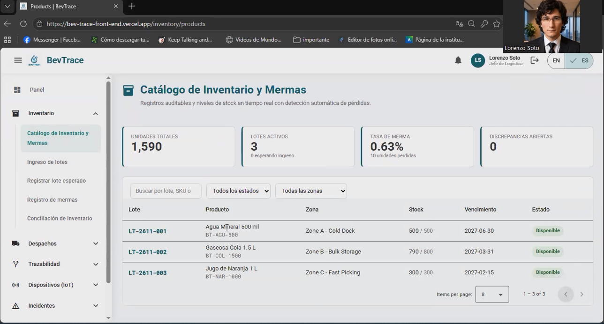

## 5.3. Validation Interviews
 
### 5.3.1. Diseño de Entrevistas
 
Las entrevistas de validación se plantean con el objetivo de evaluar la percepción de los usuarios después de interactuar con la Landing Page y la aplicación web de BevTrace. A diferencia de las entrevistas exploratorias realizadas en el Capítulo II, esta etapa se enfoca en validar la claridad de la propuesta de valor, la facilidad de navegación, la comprensión de las funcionalidades principales y la utilidad percibida por los segmentos objetivo.
 
Para esta validación se consideran los dos segmentos principales definidos para BevTrace:
 
- Jefes y Gerentes de Logística (Buyer Persona).
- Operarios y Supervisores de Almacén (User Persona).
La dinámica de la entrevista consiste en presentar primero la Landing Page de BevTrace, para observar si el usuario comprende el problema que busca resolver la solución, la confianza que transmite y la claridad de sus secciones. Posteriormente, se muestra la aplicación web, revisando el inicio de sesión, el panel de control operativo, el menú de navegación y los módulos principales (Inventario, Despachos, Trazabilidad, Monitoreo IoT, Incidencias y Reportes) según corresponda al rol del entrevistado.
 
En el caso del segmento de Jefes y Gerentes de Logística, la evaluación se orienta al panel de control, la programación y priorización de despachos, el seguimiento de lotes en ruta, la configuración de alertas, los indicadores logísticos (OTIF, Fill Rate, ERI, rotación de inventario, tasa de mermas) y la gestión de la suscripción. En el caso del segmento de Operarios y Supervisores de Almacén, se evalúa la recepción y escaneo de lotes, el registro de mermas, la validación masiva de pallets antes de la salida, el registro de salida del despacho y las notificaciones de incidencias. Al finalizar la demostración, el entrevistado responde un conjunto de preguntas diseñadas para recoger sus opiniones, dificultades y recomendaciones de mejora.
 
#### Guía de preguntas para el segmento Jefes y Gerentes de Logística
 
1. ¿Cuál es su cargo actual y cuántos años de experiencia tiene en la gestión logística de distribución?
2. ¿Cómo realiza hoy el seguimiento de inventarios, despachos y mermas en su operación?
3. Al ver la Landing Page de BevTrace, ¿entiende rápidamente qué problema busca resolver la plataforma?
4. ¿La información de la Landing Page le genera confianza para solicitar una demostración o contactar al equipo comercial? ¿Por qué?
5. ¿Qué sección de la Landing Page le pareció más útil o clara para su rol?
6. ¿Hubo alguna parte de la Landing Page que le pareció confusa, innecesaria o poco creíble?
7. ¿Qué información adicional (casos de éxito, precios, integraciones) esperaría encontrar antes de contactar a BevTrace?
8. Al iniciar sesión en la plataforma, ¿le resultó claro hacia dónde debía ir primero?
9. ¿El panel de control le muestra la información que necesita para iniciar su jornada y tomar decisiones rápidas?
10. ¿Los nombres de las secciones del menú (Inventario, Despachos, Trazabilidad, Monitoreo IoT, Incidencias, Reportes) le resultan comprensibles?
11. ¿Le resultó fácil programar un despacho, asignarle un vehículo y cambiar su prioridad?
12. ¿La vista de seguimiento en tiempo real (mapa de ruta y checkpoints) le permitiría dejar de depender de llamadas al transportista?
13. ¿El panel de conectividad de dispositivos IoT le ayuda a identificar a tiempo qué lotes pierden visibilidad?
14. ¿Las alertas e incidencias generadas por la plataforma le parecen oportunas, claras y fáciles de gestionar (reconocer, corregir, resolver)?
15. ¿Los indicadores del reporte consolidado (OTIF, Fill Rate, ERI, rotación y tasa de mermas) son los que usted necesita presentar a la alta dirección?
16. ¿Qué indicador o dato importante considera que falta en los reportes o en el panel?
17. ¿Qué tan fácil de entender le resultó el proceso de suscripción, los planes y la facturación?
18. ¿El lenguaje y los términos usados en la plataforma coinciden con cómo se habla en su operación? ¿Le resulta útil el cambio de idioma?
19. ¿Qué parte de la plataforma le resultó más difícil de usar o encontrar?
20. Después de probar BevTrace, ¿la adoptaría en su empresa? ¿Qué tendría que mejorar o integrarse (por ejemplo, con SAP) para que sí lo haga?
#### Guía de preguntas para el segmento Operarios y Supervisores de Almacén
 
1. ¿Cuál es su rol dentro del almacén o centro de distribución y qué dispositivos utiliza durante su trabajo?
2. ¿Cómo registra hoy la recepción de lotes, las mermas y la salida de los despachos?
3. Al ver la Landing Page de BevTrace, ¿queda claro que la plataforma también está pensada para el personal de almacén?
4. ¿Qué información de la Landing Page le ayudó más a entender el valor de BevTrace para su trabajo diario?
5. ¿Qué información agregaría a la Landing Page para que un operario o supervisor confíe más en la plataforma?
6. Al iniciar sesión, ¿la pantalla principal le permite entender rápidamente qué tareas tiene pendientes?
7. ¿Los nombres de las opciones del menú le resultan comprensibles y fáciles de ubicar?
8. ¿Le resultó fácil consultar el catálogo de productos y el stock disponible por lote y zona?
9. ¿El proceso de recepción de un lote mediante el código es claro y rápido? ¿Qué le agregaría o quitaría?
10. ¿El formulario para registrar una merma (cantidad y motivo) le permite registrar lo que necesita?
11. ¿Cómo evaluaría la validación masiva de pallets frente al conteo manual que realiza actualmente?
12. ¿El mensaje de discrepancia entre la carga y la orden de despacho es claro sobre qué debe corregir?
13. ¿Le resultó claro cómo registrar la salida del transporte una vez autorizado el despacho?
14. ¿Las notificaciones de alertas, incidencias o reconexión de dispositivos le parecen oportunas y fáciles de entender?
15. ¿Los botones, textos y tamaños de la interfaz le resultan cómodos para usarlos mientras trabaja en el almacén?
16. ¿La plataforma le ahorraría tiempo frente al uso de papel y la transcripción posterior en computadora?
17. ¿Hubo alguna pantalla, botón o texto que no entendió durante la prueba?
18. ¿Qué tipo de capacitación o acompañamiento necesitaría su equipo para usar BevTrace en el día a día?
19. ¿Qué parte de la plataforma le resultó más difícil de usar o encontrar?
20. Después de probar BevTrace, ¿la usaría en su trabajo diario? ¿Qué cambios serían prioritarios?
    
### 5.3.2. Registro de Entrevistas
 
A continuación se presentan los registros detallados de las entrevistas semiestructuradas realizadas a los representantes de los segmentos objetivo identificados para el proyecto BevTrace: el Segmento 1 (Jefes y Gerentes de Logística) y el Segmento 2 (Operarios y Supervisores de Almacén).
 
#### Entrevistados del segmento 1 (Jefes y Gerentes de Logística)
 
| N° de Entrevista | Datos del Entrevistado | Evidencia de Video |
|:---:|:---|:---|
| E1 | Lorenzo Soto, 28 años, Gerente de Logistica      | Duración de video: 16:02   [Enlace de entrevista](https://drive.google.com/file/d/1yRKP967dpHZVmUgqLukwyNh1eWqOsskM/view?usp=sharing) |
| E2 | (pendiente) | Duración de video: (pendiente) [Enlace de entrevista](#) |
 
#### Entrevistados del segmento 2 (Operarios y Supervisores de Almacén)
 
| N° de Entrevista | Datos del Entrevistado | Evidencia de Video |
|:---:|:---|:---|
| E1 | (pendiente) | Duración de video: (pendiente) [Enlace de entrevista](#) |
| E2 | (pendiente) | Duración de video: (pendiente) [Enlace de entrevista](#) |

### 5.3.3. Evaluaciones según heurísticas
 
**UX Heuristics & Principles Evaluation**
 
Usability - Inclusive Design - Information Architecture
 
**CARRERA:** Ingeniería de Software
**CURSO:** 1ASI0729 Desarrollo de Aplicaciones Open Source
**NRC:** 16692
**PROFESORES:** Angel Augusto Velásquez Nuñez
**AUDITOR:** Mauricio Sebastian Castillo Yataco, Enrique Augusto Ochoa Prado (Equipo CodeCraft)
**CLIENTE(S):** Jefes y Gerentes de Logística, Operarios y Supervisores de Almacén de empresas embotelladoras y distribuidoras
**SITE o APP A EVALUAR:**
BevTrace Web (Plataforma SaaS para la gestión logística, trazabilidad y monitoreo IoT de bebidas en envases PET)
 
**TAREAS A EVALUAR:**
 
El alcance de esta evaluación incluye la revisión de la usabilidad de las siguientes tareas:
 
1. Registro de usuario e inicio de sesión en la plataforma.
2. Consulta del panel de control operativo y cambio de idioma de la interfaz.
3. Recepción de un lote y registro de una merma de producto.
4. Programación de un despacho, asignación de vehículo y validación de la carga antes de la salida.
5. Seguimiento de un lote en tránsito (mapa de ruta, checkpoints y estado de dispositivos IoT).
6. Gestión de una incidencia (reconocimiento, acción correctiva y resolución).
7. Generación del reporte consolidado de indicadores logísticos (OTIF, Fill Rate, ERI, rotación y tasa de mermas).
8. Suscripción a un plan con pago simulado y consulta del historial de facturación.
No están incluidas en esta versión de la evaluación las siguientes tareas:
 
1. (completar, p. ej., integración con sistemas externos vía API/Webhooks).
2. (completar, p. ej., exportación de indicadores en JSON/CSV).
3. (completar).
**ESCALA DE SEVERIDAD:**
 
Los errores serán puntuados tomando en cuenta la siguiente escala de severidad:
 
| Nivel | Descripción |
|:---:|:---|
| 1 | **Problema superficial:** Puede ser fácilmente superado por el usuario y ocurre con muy poca frecuencia. No necesita ser arreglado a no ser que exista disponibilidad de tiempo. |
| 2 | **Problema menor:** Puede ocurrir un poco más frecuentemente o es un poco más difícil de superar para el usuario. Se le debería asignar una prioridad baja para resolverlo de cara al siguiente release. |
| 3 | **Problema mayor:** Ocurre frecuentemente o los usuarios no son capaces de resolverlos. Es importante que sean corregidos y se les debe asignar una prioridad alta. |
| 4 | **Problema muy grave:** Un error de gran impacto que impide al usuario continuar con el uso de la herramienta. Es imperativo que sea corregido antes del lanzamiento. |
 
**TABLA RESUMEN:**
 
| # | Problema | Escala de severidad | Heurística/Principio violada(o) |
|:---:|:---|:---:|:---|
| 1 | (pendiente) | (1-4) | (pendiente) |
| 2 | (pendiente) | (1-4) | (pendiente) |
| 3 | (pendiente) | (1-4) | (pendiente) |
| 4 | (pendiente) | (1-4) | (pendiente) |
 
**DESCRIPCIÓN DE PROBLEMAS:**
