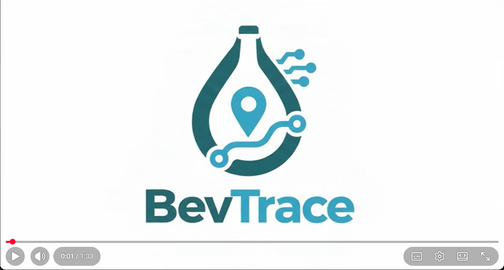

## 5.4. Video About-the-Product.

El Video About-the-Product presenta BevTrace a los visitantes de la Landing Page y a los usuarios de la aplicación, con un tono promocional y cercano, consistente con el del producto. El video inicia planteando el problema del segmento: hasta el 15% de la producción de bebidas se pierde en la cadena de distribución por mermas no detectadas y controles manuales en papel, y las embotelladoras y distribuidoras de envases PET que operan con planillas dispersas descubren estas pérdidas demasiado tarde.

A continuación, el video explica el modelo de negocio de BevTrace, basado en un esquema de suscripción accesible y escalable, con planes para negocios medianos y grandes. Luego muestra las principales características del producto con escenas de la plataforma: el registro y la actualización del stock por lote en el módulo de inventarios, la asignación de vehículos, rutas y choferes en la gestión de despachos con la autorización de cada salida, el monitoreo en tiempo real de la ubicación y el estado de los productos en ruta, y el panel de indicadores que alerta sobre anomalías. El video cierra destacando los beneficios de optimizar los tiempos de entrega y reducir las mermas no justificadas, e invita a los visitantes a probar la plataforma.

El video incluye además la opinión de un participante de las entrevistas de validación por cada segmento objetivo. Lorenzo Soto, Gerente de Logística, destaca que antes dependían de reportes manuales dispersos y descubrían las pérdidas demasiado tarde, y que con el panel de KPIs en tiempo real de BevTrace toman decisiones informadas y controlan las mermas de inmediato. María López, del segmento de Operarios y Supervisores de Almacén, señala que el sistema de lectura masiva y los escáneres facilitan el trabajo diario en el almacén, permitiendo despachar los camiones más rápido y eliminar el conteo manual repetitivo.

  
  
<em>Figura: Video About-the-Product de BevTrace</em>

<strong>Video en Microsoft Stream:</strong> <a href="#" target="_blank">URL pendiente</a>

<strong>Video en YouTube, incrustado en la Landing Page:</strong> <a href="https://youtu.be/_zAtXfpBqgs" target="_blank">https://youtu.be/_zAtXfpBqgs</a>

<strong>Duración:</strong> 1:33

