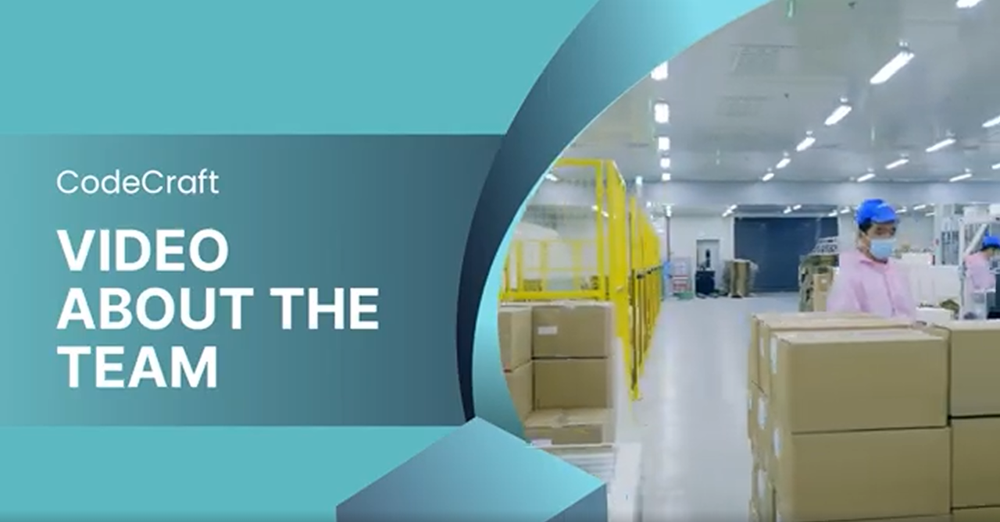

# Conclusiones

## Conclusiones y recomendaciones.

- El proceso de needfinding permitió al equipo comprender la problemática real de la gestión logística en plantas embotelladoras de bebidas: mediante entrevistas a jefes y gerentes de logística y a operarios y supervisores de almacén, el análisis competitivo (SAP EWM, WebFleet y Verial) y la técnica de Event Storming, se evidenció que el registro manual de lotes y mermas, la falta de visibilidad del despacho en ruta y la detección tardía de incidencias generan pérdidas de producto, discrepancias de inventario y demoras en la toma de decisiones.
- La aplicación de Lean UX (problem statements, assumptions, hypotheses y Lean UX Canvas) orientó las decisiones del equipo hacia las necesidades reales de ambos segmentos objetivo; cada User Story del Product Backlog proviene de hipótesis validadas con entrevistas y del Impact Map construido a partir de los business goals, evitando el desarrollo de funcionalidades sin sustento.
- La modelación del dominio mediante Big Picture EventStorming y Design-Level EventStorming permitió identificar los nueve bounded contexts de BevTrace (Shared, IAM, Subscription, Inventory, Dispatch, Traceability, Telemetry, Incident y Analytics), junto con sus commands, events, policies, aggregates y read models, estableciendo un lenguaje ubicuo que se refleja de manera consistente en la arquitectura, los diagramas de clases y el diseño de la base de datos.
- La arquitectura de software orientada al dominio, documentada con diagramas C4 (contexto, contenedores y componentes) elaborados en Structurizr DSL y con diagramas de clases y de base de datos en PlantUML, proporcionó al equipo una visión clara del sistema antes de implementar, lo que simplificó la asignación de responsabilidades por bounded context y la organización del frontend en módulos Angular con las capas domain, application, infrastructure y presentation.
- La implementación del Sprint 2 demostró la capacidad del equipo de traducir los requerimientos en un producto funcional: la Frontend Web Application de BevTrace integra los nueve bounded contexts con soporte bilingüe ES/EN, consume una Mock API desplegada en Railway y se encuentra desplegada en Vercel, permitiendo simular el flujo logístico completo desde el ingreso de lotes hasta el reporte de indicadores.
- La gestión de la configuración de software bajo GitFlow (ramas feature por bounded context, integración mediante Pull Requests hacia develop, Conventional Commits y Semantic Versioning) garantizó la trazabilidad de cada cambio y la atribución correcta del aporte de cada integrante, evidenciada en las métricas de colaboración del repositorio y en la matriz LACX del sprint.
- La distribución de responsabilidades mediante la matriz de liderazgo y colaboración (LACX), con un líder por grupo de bounded contexts y colaboradores en los demás aspectos, permitió desarrollar en paralelo sin bloqueos entre módulos, gracias a que la capa Shared (layout, internacionalización y clases base) se construyó al inicio del sprint y sirvió de fundamento para los demás contextos.
- La implementación del Sprint 3 reemplazó la Mock API por los Web Services RESTful de BevTrace, desarrollados con Java 21, Spring Boot 4, Spring Data JPA, Spring Security con JWT y MySQL, y organizados en los mismos bounded contexts del Capítulo IV con las capas domain, application, infrastructure e interfaces. Con ello, las reglas de negocio de inventario, despachos, trazabilidad, telemetría, incidencias, analítica y suscripción dejaron de ejecutarse en el navegador y pasaron a comandos de dominio con persistencia real en una base de datos administrada.
- El Sprint 3 Goal se cumplió en sus tres criterios de confirmación: los usuarios se registran e inician sesión obteniendo un token JWT, los 88 endpoints documentados con OpenAPI pueden ejecutarse desde Swagger UI con los Web Services desplegados en Railway, y la Frontend Web Application desplegada en Vercel consume los Web Services en lugar de la Mock API. De las Technical Stories planificadas quedó pendiente la TS03 (webhook de notificación de despacho completado), que pasa al siguiente sprint.
- Haber mantenido en los Web Services los mismos nombres de recursos que consumía la aplicación Angular facilitó la migración del frontend. La revisión posterior de la API, con nombres de recursos en plural y acciones expresadas como recursos (por ejemplo, registrations, tokens, permissions y revocations), alineó los Web Services con las convenciones REST y permitió incorporar la gestión de permisos por usuario y las acciones restringidas según el rol.
- Las entrevistas de validación, realizadas con un representante de cada segmento objetivo sobre la Landing Page y la aplicación web, dieron una primera retroalimentación sobre el Problem Statement: María López, operaria de almacén, mostró una percepción favorable, en especial sobre la distribución, la asignación de lotes y el registro de mermas, lo que respalda los supuestos de las funcionalidades de gestión de inventarios y de despachos (Hipótesis 1 y 2). Lorenzo Soto, Gerente de Logística, tuvo una percepción general neutral de la plataforma.
- Con una sola entrevista por segmento no es posible medir los criterios de éxito definidos en los Lean UX Hypothesis Statements, que exigen que entre el 70% y el 80% de los usuarios reporte una mejora o complete correctamente las tareas. Por ello, las hipótesis se consideran con evidencia inicial favorable en inventario y despachos, pero no validadas; las hipótesis de trazabilidad, monitoreo IoT, alertas e indicadores (Hipótesis 3 a 6) requieren pruebas con más usuarios y, en el caso del monitoreo IoT, con dispositivos reales.
- La evaluación heurística de BevTrace Web identificó cinco problemas de usabilidad y diseño inclusivo: dos de severidad mayor (la conciliación de inventario no señala el lote con discrepancia y la pantalla de planes no indica la suscripción vigente) y tres de severidad menor (el tiempo sin señal de los dispositivos en minutos acumulados, los estados de los checkpoints distinguidos solo por color y los lotes de mermas identificados solo por código). Estos hallazgos muestran que, aunque los flujos funcionan de extremo a extremo, la interfaz aún exige al usuario interpretar o buscar información que la plataforma podría presentarle directamente.
- Los videos About-the-Product y About-the-Team, junto con la Landing Page bilingüe y sus páginas legales, permitieron comunicar BevTrace a clientes potenciales y a la comunidad académica, y documentar el aporte de cada integrante del equipo en el desarrollo del producto.

### Recomendaciones.

- Corregir en el siguiente sprint los dos problemas de severidad mayor de la evaluación heurística: resaltar en la conciliación de inventario el lote y la cantidad de cada discrepancia, e indicar en la pantalla de planes cuál es la suscripción vigente del cliente. Luego, atender los tres problemas de severidad menor.
- Ampliar las entrevistas de validación a más usuarios de ambos segmentos, en número suficiente para medir los porcentajes de los criterios de éxito de los Lean UX Hypothesis Statements, y profundizar con el segmento de Jefes y Gerentes de Logística en el panel de control y los indicadores, dado que su percepción fue neutral.
- Implementar la Technical Story TS03 (webhook de notificación de despacho completado) para habilitar la integración con sistemas externos de los clientes.
- Integrar dispositivos IoT reales para el contexto de Telemetry, de modo que las lecturas de ubicación y los periodos de desconexión provengan de hardware físico, y así validar la Hipótesis 4 y las políticas de pérdida y restauración de conectividad modeladas en el dominio.
- Incorporar pruebas automatizadas por bounded context en los Web Services y en la Frontend Web Application, y automatizar su ejecución y el despliegue mediante un pipeline de CI/CD, para reducir la verificación manual en cada release.
- Mantener el registro de control de versiones, el Student Outcome y las métricas de colaboración actualizados en cada entrega, acumulando las conclusiones por avance de forma continua.

## Video About-the-Team.

El Video About-the-Team presenta al equipo CodeCraft y el trabajo realizado en el desarrollo de BevTrace. El video inicia con una portada del equipo y escenas de operaciones de almacén que contextualizan el problema logístico que aborda el producto. A continuación, cada integrante brinda su testimonio ante cámara.

Mauricio Castillo resume el concepto de BevTrace, describe sus aportes tanto en la Frontend Web Application como en los Web Services, y finaliza explicando lo que aprendió al desarrollar BevTrace y cómo lo ha implementado y lo seguirá implementando. Enrique Ochoa describe su trabajo en los bounded contexts de Telemetry y Traceability, en Angular y en Spring Boot, el despliegue de los Web Services en Railway, la documentación del Sprint 3 en el informe y las lecciones que preparó para el curso de Java; luego explica cómo el proyecto le permitió comunicarse de forma oral y escrita con distintas audiencias, y las competencias que desarrolló en diseño orientado al dominio, servicios RESTful con seguridad JWT, despliegue en la nube y trabajo colaborativo con GitFlow.

| Sección | Inicio (hh:mm:ss) |
|:---|:---:|
| Introducción | 00:00:07 |
| Testimonio de Castillo Yataco, Mauricio Sebastian | 00:00:30 |
| Testimonio de Ochoa Prado, Enrique Augusto | 00:01:25 |
| Cierre | 00:02:39 |

  
  
<em>Figura: Video About-the-Team del equipo CodeCraft</em>

| Plataforma | Enlace | Duración |
|:---|:---|:---:|
| Microsoft Stream | [Ver video en Microsoft Stream](https://upcedupe-my.sharepoint.com/:v:/g/personal/u202411222_upc_edu_pe/IQCLLyXpAWxoQ7I5Sm77bKbzAamY75xbwK79PrkNYgiEvtw?e=Zfh0AS) | 2:51 |
| YouTube, incrustado en la Landing Page | [Ver video en YouTube](https://youtu.be/MKmzsqJC4GI) | 2:51 |
